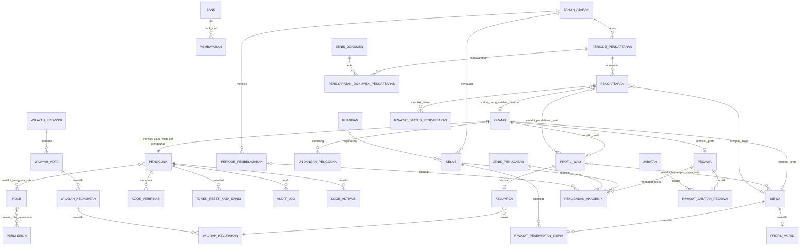
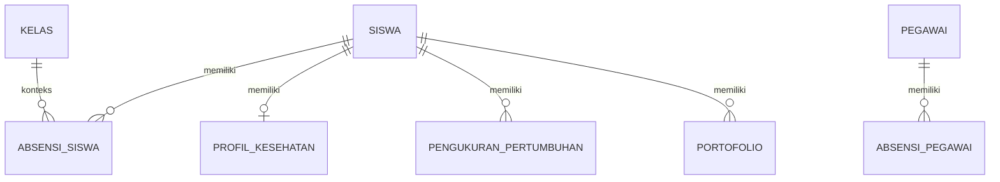
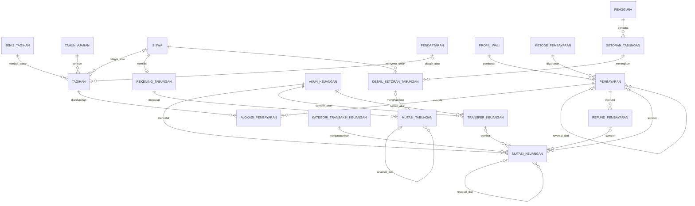

# ERD Logis TELAGA v2

- Status: ERD konseptual/logis, bukan DDL siap produksi. Disinkronkan dengan `data-dictionary.md`.
- Database yang dipilih: MySQL.
- Penamaan: tabel domain `snake_case` Bahasa Indonesia; PK `id_<entitas>`; FK memakai nama PK yang dirujuk (DEC-028). Tabel kerangka Laravel tidak digambarkan.
- Tipe data final, panjang kolom, unique index, check constraint, dan strategi soft delete ditetapkan bersama data dictionary dan versi MySQL hosting target.

## 1. ERD inti — identitas, akademik, PPDB, dan penempatan

## 2. ERD logis — kesiswaan dan kehadiran

## 3. ERD logis — keuangan dan tabungan

Pembayaran, alokasi, mutasi keuangan, setoran tabungan, dan mutasi tabungan adalah catatan bisnis yang berbeda. Jangan menyatukannya dalam satu tabel transaksi generik yang menghilangkan integritas FK. `tagihan` terikat tepat satu dari `siswa` atau `pendaftaran`.

## 4. ERD logis — dokumen, komunikasi, rapor, dan CMS

```mermaid
erDiagram
    JENIS_DOKUMEN ||--o{ DOKUMEN : mengelompokkan
    DOKUMEN ||--o{ VERSI_DOKUMEN : memiliki_versi
    VERSI_DOKUMEN ||--o{ VERIFIKASI_DOKUMEN : diverifikasi
    JENIS_SURAT ||--o{ TEMPLATE_SURAT : memiliki_template
    TEMPLATE_SURAT ||--o{ SURAT : dipakai_untuk
    JENIS_SURAT ||--o{ SURAT : jenis
    PENGUMUMAN ||--o{ TARGET_PENGUMUMAN : menargetkan
    PENGUMUMAN ||--o{ VERSI_PENGUMUMAN : memiliki_versi
    PENGUMUMAN ||--o{ PENERIMA_PENGUMUMAN : dikirim_ke
    PENGGUNA ||--o{ PENERIMA_PENGUMUMAN : menjadi_penerima
    PENGGUNA ||--o{ NOTIFIKASI : menerima
    KALENDER_AKADEMIK ||--o{ AGENDA : memiliki
    TAHUN_AJARAN ||--o{ KALENDER_AKADEMIK : memiliki
    JENIS_KEGIATAN ||--o{ AGENDA : mengategorikan
    SISWA ||--o{ RAPOR : memiliki
    PERIODE_PEMBELAJARAN ||--o{ RAPOR : periode
    BUTIR_CAPAIAN ||--o{ RAPOR_CAPAIAN : dinilai
    RAPOR ||--o{ RAPOR_CAPAIAN : tingkat
    RAPOR ||--o{ RAPOR_BAGIAN : narasi
    RAPOR ||--o{ RAPOR_PANCA_CINTA : aspek
    RAPOR ||--o{ RAPOR_FOTO : dokumentasi
    RAPOR ||--o{ RAPOR_PENGUKURAN : ddtk
    RAPOR ||--o{ RAPOR_EKSTRAKURIKULER : ekstra
    RAPOR ||--o{ RAPOR_REFLEKSI : refleksi
    RAPOR ||--o{ RAPOR_VERSI : mempunyai_snapshot
    PEGAWAI ||--o{ TANDA_TANGAN : memiliki
    MEDIA }o--o{ GALERI : melalui_galeri_media
    HALAMAN ||--o{ MEDIA : referensi_opsional
    PERIODE_PENDAFTARAN o|--o{ INFORMASI_PENDAFTARAN : konten
```

Entitas rapor mengikuti struktur template LCPA; field final dirancang saat Tahap 6 dan setelah proof of concept PDF. Entitas pendukung tanpa relasi bisnis di diagram: `riwayat_pengiriman_email`, `pengaturan_sistem`, `riwayat_pengaturan_sistem`, `profil_sekolah`, `penomoran`, `program_sekolah`, `pengaturan_website`, `audit_log` (dirujuk pada diagram 1).

## 5. Kelompok entitas

### Identitas & akses
- `orang`, `pengguna`, `kode_verifikasi`, `token_reset_kata_sandi`, `undangan_pengguna`, `role`, `permission`, `pengguna_role`, `role_permission`, `audit_log`.
- `siswa`, `profil_wali`, `hubungan_siswa_wali`, `pegawai`.

### Pengaturan
- `pengaturan_sistem`, `riwayat_pengaturan_sistem`, `profil_sekolah`, `penomoran`.

### Data master dan akademik dasar
- `tahun_ajaran`, `periode_pembelajaran`, `kelas`, `ruangan`, `jenis_penugasan`, `penugasan_akademik`.

### PPDB dan kesiswaan
- `periode_pendaftaran`, `persyaratan_dokumen_pendaftaran`, `pendaftaran`, `pendaftaran_wali`, `riwayat_status_pendaftaran`, `riwayat_penempatan_siswa`, `absensi_siswa`, `profil_kesehatan`, `pengukuran_pertumbuhan`, `portofolio`.

### Pegawai
- `jabatan`, `riwayat_jabatan_pegawai`, `absensi_pegawai`, `tanda_tangan`.

### Keuangan
- `jenis_tagihan`, `tagihan`, `pembayaran`, `alokasi_pembayaran`, `refund_pembayaran`, `metode_pembayaran`, `akun_keuangan`, `kategori_transaksi_keuangan`, `mutasi_keuangan`, `transfer_keuangan`, `rekening_tabungan`, `setoran_tabungan`, `detail_setoran_tabungan`, `mutasi_tabungan`.

### Administrasi dan komunikasi
- `jenis_surat`, `template_surat`, `surat`, `jenis_dokumen`, `dokumen`, `versi_dokumen`, `verifikasi_dokumen`, junction dokumen eksplisit, `kalender_akademik`, `jenis_kegiatan`, `agenda`, `pengumuman`, `target_pengumuman`, `versi_pengumuman`, `penerima_pengumuman`, `notifikasi`, `riwayat_pengiriman_email`.

### Rapor dan CMS
- `rapor`, `butir_capaian`, `rapor_capaian`, `rapor_bagian`, `rapor_panca_cinta`, `rapor_foto`, `rapor_pengukuran`, `rapor_ekstrakurikuler`, `rapor_refleksi`, `rapor_versi` (detail setelah PoC); `halaman`, `program_sekolah`, `galeri`, `media`, `galeri_media`, `informasi_pendaftaran`, `pengaturan_website`.

## 6. Hal yang belum boleh dianggap final

1. Struktur detail data rapor dan cara mengarsipkan snapshot PDF.
2. Field-level dictionary untuk entitas Tahap 3 dan seterusnya.
3. Batas unique key untuk orang, nomor identitas, dan data wali (pencocokan manual, DEC-027).
4. Cara mengelola saldo rekening dan saldo tabungan sebagai nilai turunan/cache.
5. Detail field dan constraint harus cocok dengan versi MySQL hosting; jangan menggunakan fitur MySQL yang belum terverifikasi.
